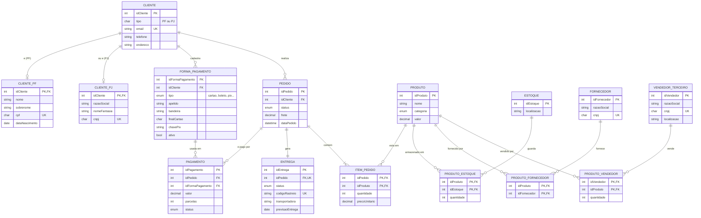

# Projeto Lógico de Banco de Dados: E-commerce

Desafio de projeto da DIO: **construir em MySQL o projeto lógico de um e-commerce**, partindo do esquema do curso (clientes, produtos, pedidos, estoque, fornecedores e vendedores terceiros) refinado com três pontos novos. O repositório contém o script de criação do esquema, a carga de dados de teste e consultas SQL que respondem a perguntas de negócio.

O que há no repositório:

- **Esquema lógico** (`sql/01_schema.sql`): 15 tabelas com chaves primárias, estrangeiras e constraints.
- **Dados de teste** (`sql/02_dados.sql`): 10 clientes, 13 pedidos, 18 pagamentos e 13 entregas.
- **Consultas** (`sql/03_consultas.sql`): 26 consultas com `SELECT`, `WHERE`, atributos derivados, `ORDER BY`, `HAVING` e junções.

## Objetivo do desafio

| # | Requisito | Como foi resolvido |
|---|-----------|--------------------|
| 1 | **Cliente PJ e PF**: uma conta pode ser PJ ou PF, mas não pode ter as duas informações | Generalização/especialização **disjunta**: `CLIENTE` (supertipo) com `CLIENTE_PF` e `CLIENTE_PJ` (subtipos). O banco impede que o mesmo cliente exista nos dois subtipos. |
| 2 | **Pagamento**: pode ter cadastrado mais de uma forma de pagamento | Entidade `FORMA_PAGAMENTO` (1 cliente : N formas) e entidade associativa `PAGAMENTO` ligando `PEDIDO` a `FORMA_PAGAMENTO` (N:M). Um pedido também pode ser dividido em mais de uma forma. |
| 3 | **Entrega**: possui status e código de rastreio | Entidade `ENTREGA` (1:1 com `PEDIDO`) com atributos `status` e `codigoRastreio`. |

## Modelo conceitual

O diagrama abaixo é renderizado automaticamente pelo GitHub (Mermaid).



## Decisões de modelagem

### 1. Cliente PF ou PJ (exclusivo)

`CLIENTE` guarda os dados comuns (e-mail, telefone, endereço) e o `tipo` da conta. Os dados específicos ficam em `CLIENTE_PF` (CPF, nome, data de nascimento) ou `CLIENTE_PJ` (CNPJ, razão social).

A regra "não pode ter as duas informações" é imposta pelo próprio banco, e não só pela aplicação:

- `CLIENTE` tem `UNIQUE (idCliente, tipo)`.
- Cada subtipo repete a coluna `tipo`, fixa o valor com `CHECK` (`'PF'` ou `'PJ'`) e referencia o par `(idCliente, tipo)` do supertipo.
- Resultado: um cliente marcado como `PF` só consegue linha em `CLIENTE_PF`. Tentar criar a linha em `CLIENTE_PJ` viola a chave estrangeira.

Limitação conhecida: o SQL não obriga que todo cliente tenha uma linha em algum subtipo (participação total). Isso é feito na aplicação, inserindo `CLIENTE` e o subtipo na mesma transação.

### 2. Várias formas de pagamento

- `FORMA_PAGAMENTO` é a "carteira" do cliente: cartão de crédito, cartão de débito, boleto, Pix ou transferência. Só guardamos dados de identificação do cartão (bandeira e 4 últimos dígitos), nunca o número completo ou o CVV.
- `PAGAMENTO` é a entidade associativa entre `PEDIDO` e `FORMA_PAGAMENTO`, com valor, parcelas e status. Assim um pedido pode ser pago com mais de uma forma (por exemplo, cartão + Pix).
- Ambas as chaves estrangeiras de `PAGAMENTO` incluem `idCliente`, o que impede pagar o pedido de um cliente com a forma de pagamento de outro.

### 3. Entrega com status e rastreio

- `ENTREGA` tem relação 1:1 com `PEDIDO` e separa o **status da entrega** do **status do pedido**.
- Status da entrega: `PREPARANDO`, `POSTADO`, `EM_TRANSITO`, `SAIU_PARA_ENTREGA`, `ENTREGUE`, `DEVOLVIDO`.
- O `codigoRastreio` é único e só pode ficar vazio enquanto a entrega está em `PREPARANDO`, porque o código só existe depois da postagem. Entregas `ENTREGUE` exigem `dataEntrega`.

## Esquema lógico

Mapeamento do modelo EER para o modelo relacional (banco `ecommerce`, MySQL 8.0.16+):

| Tabela | Chave primária | Chaves estrangeiras | Constraints principais |
|--------|----------------|---------------------|------------------------|
| `cliente` | `idCliente` | | `email` único; `UNIQUE (idCliente, tipo)`; `tipo IN ('PF','PJ')` |
| `cliente_pf` | `idCliente` | `(idCliente, tipo)` → `cliente` | `cpf` único; `tipo = 'PF'` |
| `cliente_pj` | `idCliente` | `(idCliente, tipo)` → `cliente` | `cnpj` único; `tipo = 'PJ'` |
| `forma_pagamento` | `idFormaPagamento` | `idCliente` → `cliente` | cartão exige bandeira, final e validade; Pix exige chave; `UNIQUE (idFormaPagamento, idCliente)` |
| `pedido` | `idPedido` | `idCliente` → `cliente` | `frete >= 0`; `UNIQUE (idPedido, idCliente)` |
| `pagamento` | `idPagamento` | `(idPedido, idCliente)` → `pedido`; `(idFormaPagamento, idCliente)` → `forma_pagamento` | `valor > 0`; `parcelas >= 1`; `UNIQUE (idPedido, idFormaPagamento)` |
| `entrega` | `idEntrega` | `idPedido` → `pedido` | `idPedido` único (1:1); `codigoRastreio` único; rastreio obrigatório fora de `PREPARANDO`; `ENTREGUE` exige `dataEntrega` |
| `produto` | `idProduto` | | `valor >= 0` |
| `fornecedor` | `idFornecedor` | | `cnpj` único |
| `vendedor_terceiro` | `idVendedor` | | `cnpj` único |
| `estoque` | `idEstoque` | | |
| `item_pedido` | `(idPedido, idProduto)` | `idPedido` → `pedido`; `idProduto` → `produto` | `quantidade > 0`; `precoUnitario >= 0` |
| `produto_fornecedor` | `(idProduto, idFornecedor)` | → `produto`; → `fornecedor` | |
| `produto_vendedor` | `(idVendedor, idProduto)` | → `vendedor_terceiro`; → `produto` | `quantidade >= 0` |
| `produto_estoque` | `(idProduto, idEstoque)` | → `produto`; → `estoque` | `quantidade >= 0` |

Como cada relacionamento do modelo conceitual virou tabela:

- **Generalização/especialização disjunta** (`CLIENTE` → `PF`/`PJ`): uma tabela por tipo, com a chave do subtipo igual à chave do supertipo.
- **Relacionamentos N:M** (produto x fornecedor, produto x vendedor, produto x estoque, produto x pedido): tabelas associativas com chave primária composta. Os atributos do relacionamento, como `quantidade` e `precoUnitario`, ficam nelas.
- **Relacionamentos 1:N** (cliente → pedido, cliente → forma de pagamento): chave estrangeira no lado "N".
- **Relacionamento 1:1** (pedido → entrega): chave estrangeira com restrição `UNIQUE` no lado da entrega.
- **Vendedor que também é fornecedor**: não há relacionamento entre as tabelas. Quando a mesma empresa atua nos dois papéis, ela aparece nas duas tabelas com o mesmo CNPJ, e a consulta E2 faz a junção por esse campo.

## Dados de teste

`02_dados.sql` foi montado para que cada consulta tenha o que mostrar:

- clientes PF e PJ, dois deles (Beatriz e Escritório Alfa) sem nenhum pedido;
- Maria com três formas de pagamento cadastradas, e pedidos pagos com duas ou três formas (Pix + cartão, por exemplo);
- pedidos confirmados, aguardando pagamento e um cancelado (pagamento recusado);
- entregas em todos os status, duas delas atrasadas e uma devolvida;
- duas empresas (Moda Express e Eletro Import) que são vendedor terceiro e fornecedor ao mesmo tempo;
- dois produtos sem fornecedor (os brinquedos, vendidos só por terceiros) e dois com estoque baixo.

A soma dos pagamentos aprovados de cada pedido confirmado é igual a itens + frete. Os pedidos 2 e 10 ficam em aberto de propósito.

## Consultas e perguntas de negócio

Todas estão em `sql/03_consultas.sql`, com a pergunta e as cláusulas usadas em comentário.

| Cláusula | Consultas | Perguntas respondidas |
|----------|-----------|-----------------------|
| `SELECT` simples | A1, A2 | Quais produtos existem? Em que cidades há estoque? |
| `WHERE` | B1 a B4 | Eletrônicos acima de R$ 500? Pedidos confirmados em setembro? Pagamentos pendentes ou recusados? Entregas em andamento? |
| Atributos derivados | C1 a C3 | Nome completo e idade do cliente PF? Subtotal do item e preço com 10% de desconto? Total do pedido, valor pago e saldo em aberto? |
| `ORDER BY` | D1, D2 | Ranking de produtos por preço? Clientes por tipo e nome? |
| `JOIN` | E1 a E8 | **Quantos pedidos foram feitos por cada cliente?** **Algum vendedor também é fornecedor?** **Relação de produtos, fornecedores e estoques.** **Relação de nomes dos fornecedores e nomes dos produtos.** Produtos sem fornecedor? Clientes que nunca compraram? Entregas atrasadas? Acompanhamento do pedido? |
| `GROUP BY` + `HAVING` | F1 a F7 | Clientes com mais de um pedido e quanto gastaram? Pedidos pagos com mais de uma forma? Clientes com mais de uma forma cadastrada? Estoque abaixo de 20 unidades? Categorias que faturaram mais de R$ 1.000? Ticket médio PF x PJ? Entregas por status? |

As perguntas em negrito são as sugeridas no enunciado do desafio.

Exemplo, a consulta E2 (vendedor que também é fornecedor) e seu resultado com os dados de teste:

```sql
SELECT v.idVendedor, v.razaoSocial AS vendedor,
       f.idFornecedor, f.razaoSocial AS fornecedor, v.cnpj
FROM vendedor_terceiro v
JOIN fornecedor f ON f.cnpj = v.cnpj;
```

| idVendedor | vendedor | idFornecedor | fornecedor | cnpj |
|-----------:|----------|-------------:|------------|------|
| 1 | Moda Express ME | 4 | Moda Express ME | 98765432000110 |
| 3 | Eletro Import S/A | 2 | Eletro Import S/A | 22333444000155 |

## Estrutura do repositório

```
.
├── README.md
└── sql/
    ├── 01_schema.sql      # criação do banco, tabelas, PKs, FKs e CHECKs
    ├── 02_dados.sql       # persistência de dados fictícios para teste
    └── 03_consultas.sql   # consultas por cláusula e testes de integridade
```

## Como executar

Requer **MySQL 8.0.16 ou superior** (versões anteriores aceitam a sintaxe de `CHECK`, mas não a aplicam). Pode ser usado pelo MySQL Workbench ou pela linha de comando:

```bash
mysql -u root -p < sql/01_schema.sql
mysql -u root -p < sql/02_dados.sql
mysql -u root -p < sql/03_consultas.sql
```

O arquivo `03_consultas.sql` termina com quatro comandos comentados que **devem falhar**. Descomente-os para ver as regras de integridade em ação (cliente PF recebendo registro PJ, pagamento com forma de outro cliente, entrega postada sem código de rastreio).
